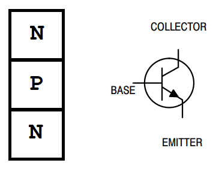
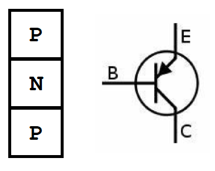
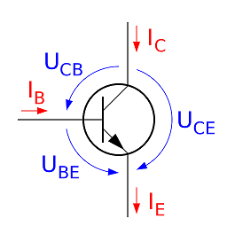
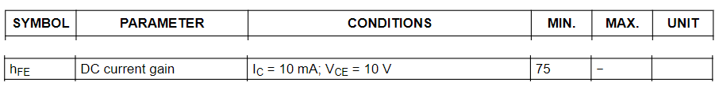

**Que fait un transistor ? Pourquoi est-il si présent dans nos circuits ?**

Pilier de l'électronique moderne, présent dans les circuits de puissance, de contrôle et surtout les circuits numériques, on n'a de cesse de le mettre absolument partout. Mais pourquoi ? Qu'a-t-il de si spécial ? Nous allons voir ça dans cet article, dans lequel je ferai un bref rappel de physique pour ceux que ça intéresse puis un guide pratique sur la façon dont on peut en tirer parti dans nos circuits.

## Rappels physiques

Le transistor est basé sur des jonctions qu'on appelle PN. Une région de type P est constituée de semi-conducteurs dopés positivement (déficit d'électrons libres) alors que la région de type N est dopée négativement (surplus d'électrons libres). Un exemple serait d'ajouter des atomes de phosphore pour la région N, la liaison phosphore-silicium ayant un électron libre, et des atomes d'aluminium dans la région P, la liaison aluminium-silicium créant un manque d'un électron.

(Le parallèle jonctions/symbole pour un transistor NPN et PNP)

Les régions N et P étant en contact direct, les électrons libres de la région N vont aller dans la région P et créer à l'interface (la jonction PN) une zone dite de déplétion, une sorte de "barrière" empêchant les électrons de passer. Avec l'image, on peut se rendre compte que la région P (ou la base) est entourée de deux de ces zones, empêchant le courant de s'écouler du collecteur à l'émetteur.

De là, sur un transistor NPN, nous avons deux façons d'impacter ces zones :

- En appliquant une tension positive ($V_{BE} > 0$) à la base, la barrière de potentiel diminue, ce qui aide les électrons à passer.
- En appliquant une tension négative ($V_{BE} < 0$) à la base, la barrière de potentiel augmente, limitant donc le passage des électrons.

À titre indicatif, la barrière de potentiel est d'environ 0.7V sur la majorité des transistors (à compléter avec une lecture de la datasheet du transistor en question)

Révélation du jour : une diode est une jonction PN !

## Fonctionnement d'un transistor bipolaire

(Je vais ici me concentrer sur le transistor NPN, qui est le plus courant, mais les calculs sont valables pour les transistors PNP, il suffit de remplacer les valeurs Vce par Vec, Vbe par Veb et Vcb par Vbc.)

### Les termes

Une image vaut mieux que 6 lignes, voici tous les termes représentant les tensions et intensités ayant lieu dans un transistor bipolaire :

Il y a également deux relations toujours vraies (loi des mailles et loi des nœuds) :

$$V_{CE} = V_{CB} + V_{BE}$$

$$I_E = I_C + I_B$$

### Le régime bloqué

Le transistor est dit en régime bloqué quand le courant de base (Ib) est nul.

Les courants Ic et Ie sont également nuls.

Vbe est inférieur à la tension de seuil (on parle de jonctions PN, donc plus ou moins de diodes, d'où le concept de tension de seuil ici), soit dans un cas général < 0.7V.

Une analogie très courante est de considérer le transistor comme un interrupteur. Ici, l'interrupteur serait ouvert (pas de contact donc).

### Le régime saturé

Le régime saturé, c'est l'inverse du régime bloqué, cette fois-ci Ib est supérieur à un seuil qu'on appelle Ibsat (on le reverra plus tard).

Il y a contact entre l'émetteur et le collecteur, la tension Vce est donc à son minimum, appelé Vcesat.

Le courant $I_C$ arrivant par le collecteur n'est pas limité par le transistor, car il agit ici comme un interrupteur fermé (à la différence que le contact n'est pas parfait -> Vce aurait été égal à 0 si c'était un contact pur, mais ici, il s'agit de diodes, donc Vce est dépendant des tensions de seuil).

### Le régime linéaire

Lorsque Ib est supérieur à 0, on n'est plus en régime bloqué. Mais si Ib est inférieur à Ibsat, le transistor n'est pas en régime saturé non plus, il se trouve dans un état intermédiaire, le régime linéaire.

Dans ce régime, le courant Ic est proportionnel au courant de base Ib par un coefficient appelé le gain (noté $\beta$ dans les calculs ou hFE dans les datasheets) qui est donné par la datasheet du transistor. Pour un transistor bipolaire NPN nommé 2N2222 (un des plus courants), le gain est d'au minimum 75.

(extrait de la datasheet du 2N2222)

Dans ce régime, donc, la valeur du courant Ic est égale à :
$$I_C = \beta \cdot I_B$$

### Utilisations d'un transistor bipolaire

Après ceci, vous devriez pouvoir déduire trois utilités principales du transistor bipolaire :

- Amplifier le courant
- Servir d'interrupteur électriquement contrôlé
- Par extension du 2ème, permet de créer des portes logiques

### Remarques

- Les régimes bloqués et saturés sont généralement appelés régimes de commutation.
- Le gain des transistors est généralement vague. L'exemple au-dessus du 2N2222 citait comme valeur minimale du gain 75, mais ne citait pas de valeur maximale. Autrement dit, c'est complètement aléatoire, mais on sait que c'est au-dessus de 75.
- Si vous avez parcouru quelques datasheets de transistor bipolaire, vous aurez sûrement remarqué quelque chose de pour le moins étrange... Ibsat (le seuil à partir duquel on sort du régime linéaire pour entrer en régime saturé) n'est pas tout le temps donné. Et pour cause, ce n'est pas une donnée strictement nécessaire ! Comment faire du coup ? Vous avez le courant $I_C$ visé par votre charge ainsi que le gain minimum $\beta_{min}$ (prenez toujours la valeur minimale garantie, pas la valeur typique). On calcule d'abord le courant limite :
$$I_B = \frac{I_C}{\beta_{min}}$$
Cependant, s'arrêter exactement à ce seuil maintient le transistor en limite de régime linéaire (avec un $V_{CE}$ élevé et une forte dissipation thermique). Pour garantir une **saturation franche** en commutation, on applique un **facteur de sursaturation** $k$ de $2$ à $5$ (soit $I_B = k \cdot \frac{I_C}{\beta_{min}}$), ou on utilise en pratique un gain forcé $\beta_{sat} \approx 10$ à $20$ (soit $I_B \approx \frac{I_C}{10}$).

## Conclusion

Dans cet article, nous avons exploré en détail le fonctionnement du transistor bipolaire. Si son utilisation peut sembler complexe au premier abord, ne vous inquiétez pas. Dans les prochains articles, nous aborderons des applications concrètes du transistor, notamment dans le domaine des circuits logiques.

Vous aurez sûrement remarqué que le transistor est ici abordé du point de vue de l'électronicien plutôt que du physicien. Il n'est pas impératif de maîtriser toutes les propriétés physiques des semi-conducteurs pour concevoir ou analyser des circuits électroniques. Cependant, si vous ressentez l'envie d'approfondir vos connaissances en physique et en chimie, n'hésitez pas à le faire, c'est un sujet passionnant !
