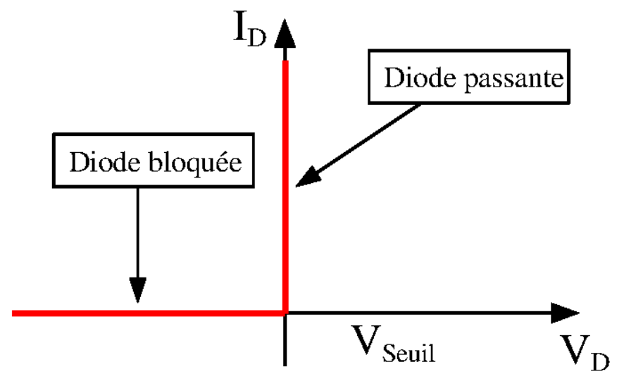
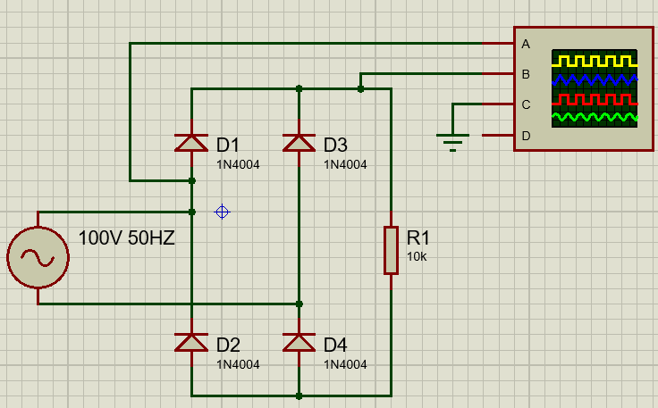
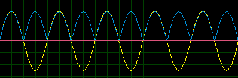
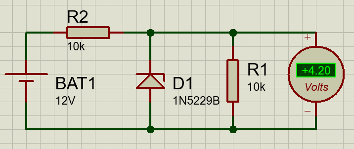

On la voit partout et dans toutes les applications. Pour redresser un signal, créer une IHM, protéger un circuit ou bien capter la lumière, les applications des diodes sont très étendues, et ça en fait un des composants les plus importants en électronique. Nous allons aujourd'hui voir comment se décrit une diode et comment l'utiliser.

## Petit rattrapage sur les diodes et diode idéale

Imaginez que vous vouliez redresser une tension alternative (la rendre continue) ou que vous vouliez protéger une partie du circuit d'un potentiel courant dans le sens inverse. Vous voudriez pouvoir utiliser un composant faisant office de "clapet anti-retour", un composant qui laisse parfaitement passer le courant dans un sens, mais pas dans l'autre. Ça tombe bien, c'est exactement ce que propose de faire la diode. Nous allons tout d'abord présenter les caractéristiques idéales d'une diode et ensuite en quoi les diodes réelles divergent.

Par diode idéale, on entend une diode avec une courbe caractéristique comme celle-ci :

Dans le meilleur des cas, la diode aurait le comportement d'un conducteur pur dans un sens et d'un isolant pur dans l'autre. La différence de potentiel aux bornes de la diode serait donc de 0 car il y aurait contact. La résistance d'une diode idéale étant nulle, elle agirait "comme un court-circuit" et laisserait passer le courant sans le bloquer.

Voici le symbole d'une diode :

On voit que le symbole représente une sorte de "flèche", on en déduira donc avec raison que le courant peut se déplacer dans le sens de la flèche, et pas dans le sens inverse. Le courant circule donc de l'anode vers la cathode.

## La diode standard et ses dérivées

### La diode standard

En réalité, la courbe caractéristique d'une diode réelle est plus proche de celle-ci :

En effet, même si on garde l'esprit de la diode idéale, la courbe est tout de même bien différente ! Les différences majeures sont :

1. La tension de seuil, notée Vd
2. La tension de claquage, notée Vbr
3. La présence d'un courant inverse (courant de fuite ou leakage current)

La tension de seuil est la tension à partir de laquelle notre diode commence réellement à se comporter comme un conducteur dans le sens de la diode. Sa valeur varie d'une diode à l'autre et pour des diodes standard elle est de l'ordre de 0.7V.

La tension de claquage est la tension inverse à laquelle la diode cesse de s'opposer au passage du courant. Dans le cas d'une diode standard, ça signifie sa mort. Elle peut fondre et se sectionner et ainsi ne plus laisser passer le courant ; dans un cas plus critique, elle peut fondre en formant un court-circuit. Cette situation peut mener à de vraies complications, comme détruire le transformateur ou les composants en aval, faire exploser des condensateurs ou provoquer un incendie, d'où l'importance de protéger le circuit. Cette tension de claquage dépend du modèle de la diode (pensez à lire la datasheet de votre modèle).

On pourrait au moins penser que jusqu'à la tension de claquage, la diode s'opposerait parfaitement au passage du courant, mais non, il existe bien un courant inverse qui arrive à passer. Nul besoin cependant de trop s'en inquiéter dans la majorité des cas, ce courant ne dépassant que rarement quelques nanoampères.

La majorité des types spéciaux de diodes jouent plus ou moins fortement sur ces trois points mentionnés plus haut. Je vais ici vous en présenter quelques-unes.

Une des applications principales de la diode standard est le redressement (d'où le nom de diode de redressement souvent utilisé). En effet, si vous avez du courant alternatif en entrée d'une diode, à la sortie vous aurez, non pas du courant continu, ce n'est pas encore pour tout de suite, mais vous aurez un courant redressé, c'est-à-dire sans crêtes négatives.

Un montage assez courant dans les alimentations se nomme le "Pont de Graetz" (ou pont de diodes) dont voici un schéma :

Le montage des diodes peut paraître au premier abord "cryptique" mais dites-vous seulement que le courant ne peut passer que dans le sens de la flèche. Il n'y a que deux solutions possibles ici :

- Le fil positif est celui du haut, il va donc monter par la diode D1, passer à travers R1 du haut vers le bas et retourner à la source par D4.
- Le fil positif est celui du bas, il va donc monter par la diode D3, passer à travers R1 du haut vers le bas et retourner à la source par D2.

Et voilà les signaux vus par l'oscilloscope branché sur le circuit :

Avec :

- En jaune le signal de 100V original
- En bleu le signal de sortie du pont de Graetz
- En rose la masse, soit un signal de 0V pour bien voir l'effet des diodes

On peut voir ici que le signal alternatif en entrée a été transformé en une tension redressée double alternance (positive, mais toujours périodique cela dit) dans laquelle toutes les valeurs négatives ont été inversées. Le signal de sortie est en quelque sorte la "valeur absolue" du signal d'entrée, pour donner une petite définition "plus mathématique".

Maintenant cette étape accomplie, pour filtrer le signal (le terme technique pour "aplatir le signal"), on pourrait ajouter un condensateur, qui viendrait stocker de l'énergie pendant les montées et en relâcher pendant les descentes, et donc lisser la courbe.

De temps en temps, on peut observer qu'une seule diode est utilisée et non quatre diodes. Cela supprime unilatéralement les crêtes négatives du signal alternatif, et donc réduit la puissance que l'on peut tirer du signal. Si l'on n'a pas besoin de beaucoup de puissance (5W depuis le secteur pour recharger un smartphone par exemple), ça peut être un moyen de gagner de la place ou des composants.

### La diode Schottky

La diode Schottky est très semblable à une diode standard, à la différence qu'elle se distingue par une tension de seuil plus faible et un temps de commutation (temps nécessaire à la diode pour passer de "bloquée" à "passante") plus court. Cela tient au fait que ce type de diode utilise une jonction métal-semiconducteur au lieu d'une jonction PN en silicium comme les diodes standard.

Grâce à sa vitesse de commutation plus élevée, elles sont souvent utilisées dans les circuits à haute fréquence comme la radio ou les alimentations à découpage (on en reparlera un jour de ça, le sujet est plutôt intéressant) et grâce à sa tension de seuil plus faible, elle devient idéale pour les applications à consommation énergétique élevée. En effet, une tension plus faible aux bornes de la diode signifie moins de pertes thermiques dues à l'effet Joule.

De là on pourrait se demander "mais pourquoi utiliser des diodes dites de redressement ou standard alors que les diodes Schottky sont tout simplement plus performantes ?".
Réponse courte, ça coûte moins cher. Réponse longue, ça coûte juste moins cher, il y a certes des situations où on hésite un peu, mais le prix joue pour beaucoup quand on doit produire un circuit en masse.

### La diode Zener

Contrairement aux diodes standard, les diodes Zener sont conçues pour fonctionner dans la région de tension inverse, où elles maintiennent une tension constante, même lorsque la tension aux bornes de la diode atteint des valeurs supérieures à la **tension Zener** ($V_Z$) spécifiée (à ne pas confondre avec la tension de seuil directe, d'environ 0,7 V).

Cela peut paraître un peu cryptique comme type de diode mais elle est en réalité très utile dans pas mal de cas. En effet, les régulateurs de tension, les circuits de limitation de tension, les circuits de protection contre les surtensions ou encore les instruments de mesure notamment peuvent avoir besoin de cette propriété en inverse.

Voici un petit exemple :

Dans ce circuit, on pourrait penser qu'en raison de la tension d'alimentation de 12V et des lois de Kirchhoff qui ici pourraient imposer que "toutes les branches en parallèle ont la même tension, soit 12V", il devrait y avoir 12V aux bornes de la résistance R1. Et pourtant non il y a 4.2V, pourquoi donc ? La diode D1 est une diode Zener, et comme on peut le remarquer, elle est branchée à l'envers, "la tête (cathode) vers le plus", cette diode est donc typiquement dans son cas d'utilisation préféré. La valeur de ce modèle ici est de 4.2V, la tension aux bornes de la diode est donc limitée à cette valeur. La différence (12 - 4.2 = 7.8V) se retrouve dans la résistance R2.

## Capteur de lumière

### La photodiode

Là on rentre dans une catégorie insoupçonnée des diodes. Le courant inverse d'une diode standard varie (extrêmement) peu quand on applique de la lumière dessus. Avec des optimisations dans la fabrication de la diode et en l'utilisant principalement en polarisation inverse (mode photoconducteur), on obtient un **photocourant inverse** ($I_{ph}$) qui réagit linéairement aux variations de lumière. On a donc littéralement un capteur de lumière. La documentation (ou datasheet) du composant contient généralement une courbe (ou la fonction associée) permettant de calculer l'éclairement lumineux en fonction du photocourant traversant la diode. Ce qui peut servir dans beaucoup de circuits qui ont un lien de près ou de loin avec l'optique.

## Un condensateur ?

### La diode Varicap

Même si c'est étrange de faire le parallèle ici, la diode a une structure similaire à un condensateur. Elle possède en effet deux zones de silicium dopées séparées par une **zone de déplétion** (dépourvue de porteurs libres et qui joue le rôle de diélectrique), ce qui n'est pas sans nous rappeler les électrodes du condensateur ! En appliquant une tension inverse variable à ce type de diode, l'épaisseur de cette zone varie et il est ainsi possible de modifier la capacité électrique dans le circuit, ce qui permet notamment de régler la fréquence d'un circuit.

## Interface Homme-Machine

### La diode électroluminescente (LED)

La LED est la diode la plus connue de toutes les diodes, une vraie star ! Cette diode émet de la lumière lorsqu'elle est traversée par un courant. Elles sont disponibles dans un large panel de couleurs et sont une solution simple et généralement économique pour créer une interface Homme-Machine. On les retrouve un peu partout autour de nous, de la lumière sur l'ordinateur/écran pour dire qu'il est "en charge" ou "allumé".

À noter que les couleurs disponibles ne sont pas forcément dans le spectre des couleurs visibles. Il existe des LED permettant d'émettre de la lumière infrarouge, invisible à l'œil nu. Un exemple bien pratique de cette diode est celui de la télécommande de la télévision. La télécommande n'est en effet pas forcément reliée à la télé par radio/wifi/bluetooth, ce qui peut être un peu lourd pour une simple télécommande. Une solution plus simple est de littéralement envoyer les instructions "dans un code lumineux" avec notre LED. La télévision se chargera de récupérer les instructions avec une photodiode, permettant de faire globalement l'inverse d'une LED.

## Conclusion

Les diodes sont des composants électroniques polyvalents et indispensables dans de nombreux domaines de l'électronique. Que ce soit pour redresser le courant électrique, réguler la tension, détecter la lumière ou créer des interfaces homme-machine, les diodes jouent un rôle crucial. En comprenant les principaux types de diodes et leurs utilisations dans les grandes lignes, nous sommes en mesure de mieux comprendre les circuits que nous pourrons lire mais aussi exploiter leur potentiel pour en concevoir.
