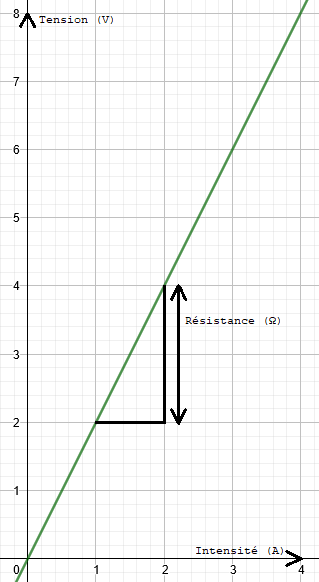
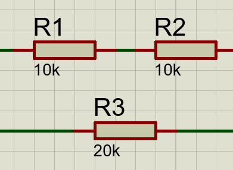
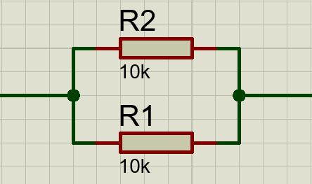
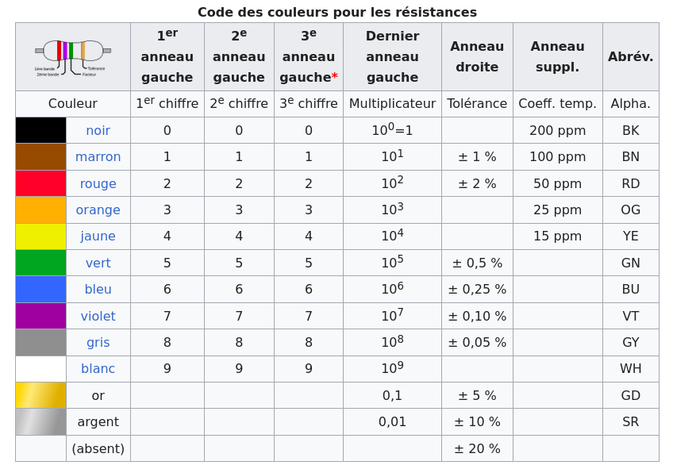

La résistance est un des composants les plus courants des circuits électroniques. Nous en avons légèrement parlé dans "[Les lois fondamentales en régime continu](/electronics/basics/course-basics-fundamental-laws-of-steady-state/)" mais dans cet article, je vais tenter de faire un résumé de tout ce qu'il y a à savoir pour pouvoir utiliser simplement ce composant.

## Les unités liées à la résistance

Dans le composant électrique qu'est la résistance, il y a quelques grandeurs que l'on peut connaître selon son type ou son matériau.

### La résistivité électrique d'un matériau

La résistivité d'un matériau (symbolisée par la lettre $\rho$ -> rho) représente sa capacité à s'opposer à la circulation d'un courant électrique. Il s'agit plus simplement de la **résistance en ohms d'un tronçon d'un mètre de longueur et d'un mètre carré de section**. Son unité est l'**ohm-mètre** de symbole **$\Omega\cdot\text{m}$**. La résistivité d'un élément métallique croît linéairement en fonction de la température selon un coefficient propre au matériau en question. (C'est cet effet qui est derrière les résistances de platine utilisées pour les sondes de température type Pt-100)

### La résistance électrique

La résistance électrique dans une résistance dépend directement de la résistivité du matériau utilisé, qu'on va venir diviser ou multiplier selon la longueur et la section de notre conducteur. Sur les résistances, la valeur de la résistance électrique est généralement donnée via un code couleur que nous verrons [juste après](#le-code-couleur-et-marquage-des-résistances), mais si l'on voulait calculer soi-même la résistance d'un conducteur, nous pourrions utiliser cette formule :

$$R = \rho \cdot \frac{L}{S}$$

Où :

- $\rho$ (rho) est la résistivité du matériau en **ohms-mètre** ($\Omega\cdot\text{m}$)
- $L$ est la longueur en **mètres** (m)
- $S$ est la section du conducteur en **mètres carrés** (m²)

### La conductance électrique

Cette unité est plus rare que son homologue la résistance mais en fait elles sont très fortement liées. En effet, la conductance électrique est le strict inverse de la résistance !

$$G = \frac{1}{R}$$

Ou via la loi d'Ohm (qui est le point d'après) :

$$G = \frac{I}{U}$$

Son symbole est généralement $G$ et son unité est le **siemens** (S).

Elle correspond à la capacité d'un conducteur à conduire le courant, contrairement à la résistance électrique qui est la faculté d'un conducteur à résister au courant. Par extension, plus la conductance est grande (et donc plus la résistance est petite), et plus le courant sera élevé.

## La loi d'Ohm

Nous avions déjà introduit cette loi dans l'article précédent (cf. "[Les lois fondamentales en régime continu](/electronics/basics/course-basics-fundamental-laws-of-steady-state/)") mais je vais quand même en refaire un rapide résumé.

**Georg Simon Ohm** en 1827 a trouvé empiriquement une relation directe entre l'intensité traversant un élément résistif (une résistance) et la tension à ses bornes. En effet, si l'on trace la courbe caractéristique d'une résistance (la tension à ses bornes en fonction du courant qui la traverse), nous voyons que le coefficient directeur de la droite est la résistance !

Dans cet exemple, nous avons une résistance de $2\,\Omega$, la tension en ordonnée et l'intensité en abscisse. Nous voyons donc que pour chaque ampère que l'on monte, la tension monte de 2 volts. Le coefficient directeur ($\Delta U / \Delta I$) est bien 2, soit la valeur de notre résistance.

On en déduit donc la formule générale de la loi d'Ohm :

$$U = R \cdot I$$

## L'effet Joule

En courant continu, l'effet Joule correspond à la perte d'énergie électrique en énergie thermique au passage d'une résistance.

Pour l'expliquer plus simplement, nous avons déjà la formule de la puissance dans un coin de notre tête :

$$P = U \cdot I$$

Ainsi que la loi d'Ohm que nous venons de revoir :

$$U = R \cdot I$$

Nous pouvons donc mélanger les deux formules et donc remplacer le $U$ présent dans la formule de la puissance par $R \cdot I$, ce qui nous donne :

$$P = R \cdot I \cdot I$$
$$P = R \cdot I^{2}$$

Grâce à cette formule, nous pouvons maintenant calculer la puissance consommée par une résistance !

Mais l'effet Joule correspond à la quantité d'énergie dissipée dans la résistance et non la puissance. Mais nous savons que l'énergie se calcule via la formule suivante :

$$W = P \cdot t$$

Et si on remet notre formule pour la puissance consommée par une résistance, nous obtenons la formule caractéristique de l'effet Joule :

$$W = R \cdot I^{2} \cdot t$$

Cette formule, assez logiquement, nous permet de calculer la quantité d'énergie dissipée par une résistance. On parle généralement de pertes thermiques, étant donné que la chaleur n'est pas une énergie intéressante dans un circuit électrique (à part si l'intérêt est de produire de la chaleur, comme dans un four ou un radiateur par exemple).

## Résistance équivalente en série

Plusieurs résistances en série sont équivalentes à une seule résistance dont la valeur est la somme des résistances composantes.

Cette règle peut être démontrée simplement avec la loi d'Ohm mais gardons simplement l'idée générale : **La résistance électrique des résistances en série s'additionne.**

Dans cet exemple, deux résistances de $10\,\text{k}\Omega$ placées en série sont équivalentes à une résistance de $20\,\text{k}\Omega$.

$$R_{eq} = \sum_{n = 1}^{k} R_n$$

Où $n$ est l'indice de la résistance courante et $k$ le nombre total de résistances en série.

Ce qui est finalement un résultat assez logique dans l'idée, si le courant est freiné deux fois par une résistance de $10\,\text{k}\Omega$, c'est la même chose que s'il était freiné une seule fois par une résistance somme de $20\,\text{k}\Omega$.

## Résistance équivalente en dérivation

Si maintenant les résistances $R_1$ et $R_2$ sont montées en dérivation, quelle sera la résistance équivalente ?

Et bien c'était tout l'intérêt d'avoir présenté la [conductance électrique](#la-conductance-électrique) un peu plus haut. En série, les résistances s'additionnent, mais en dérivation, ce sont les conductances qui s'additionnent ! Ce qui est assez logique, plusieurs conducteurs résistifs mis en parallèle conduisent mieux le courant que s'ils étaient seuls. Par extension logique que l'on validera juste après par la formule, une infinité de résistances mises en parallèle équivaut à une résistance quasi nulle.

$$G_{eq} = \sum_{n = 1}^{k} G_n$$

Où $n$ est l'indice de la résistance courante et $k$ le nombre total de résistances en parallèle.

Nous savons que la conductance est l'inverse de la résistance, donc :

$$R_{eq} = \frac{1}{\sum_{n = 1}^{k} G_n} = \frac{1}{\sum_{n = 1}^{k} \frac{1}{R_n}}$$

Ou plus simplement dans l'exemple juste au-dessus :

$$R_{eq} = \frac{1}{\frac{1}{R_1} + \frac{1}{R_2}} = 5\,\text{k}\Omega$$

À noter que dans le cas particulier où il n'y aurait que deux résistances en parallèle, il existe une formule plus simple qui consiste à faire le produit sur la somme des résistances :

$$R_{eq} = \frac{R_1 \cdot R_2}{R_1 + R_2}$$

Nous pouvons en déduire plusieurs choses :

1. La résistance équivalente de plusieurs résistances en dérivation sera toujours plus petite que la plus petite des résistances prises en compte dans le calcul, ce qui correspond à l'idée générale juste au-dessus.
2. Si deux résistances égales sont mises en dérivation, la résistance équivalente sera égale à une des résistances divisée par 2.

## Le code couleur et marquage des résistances

### Le code couleur

Comme mentionné [au début de l'article](#la-résistance-électrique), la valeur des résistances peut être donnée selon un code couleur directement dessiné sur le corps de la résistance. Le voici (les images suivantes nous viennent tout droit de la [page Wikipédia sur la résistance](https://fr.wikipedia.org/wiki/R%C3%A9sistance_(composant))) : 

Tous les anneaux ne sont pas nécessairement utilisés sur toutes les résistances, le 3ème anneau de gauche typiquement n'est présent que quand la tolérance est inférieure ou égale à 2%. La lecture se fait de gauche à droite, on lit d'abord les chiffres significatifs, puis on multiplie le nombre obtenu par le coefficient donné par le dernier anneau de gauche. Pour savoir de quel côté est la gauche et la droite, l'anneau de tolérance est généralement plus espacé que les autres, et si une extrémité est couleur or ou argent, il s'agit nécessairement de la tolérance, et donc de la droite du code couleur.

Pour une résistance typique de $1\,\text{k}\Omega$, le code couleur sera "Marron Noir Rouge" ($10 \cdot 100$) suivi d'une couleur pour la tolérance, par exemple Or pour une tolérance de 5%. Certaines résistances indiquent le coefficient de température de la résistance, qui indique en ppm la variation de résistance par degré. La majorité des résistances ont un coefficient positif, c'est-à-dire que leur résistance monte très légèrement quand leur température monte.

La tolérance est simplement la fourchette dans laquelle sera la valeur réelle de la résistance. Avec une tolérance de 5%, la valeur réelle d'une résistance donnée pour $1\,\text{k}\Omega$ sera comprise entre $950\,\Omega$ et $1050\,\Omega$. Plus la tolérance est faible et plus la valeur réelle sera proche de la valeur voulue, mais le prix va nécessairement augmenter. Dans certains cas cela peut être utile, dans d'autres pas du tout.

On peut voir une image avec plusieurs de ces composants ici :

.jpg "Résistances traversantes")

Il en existe de différentes couleurs et de différentes tailles, la différence de taille venant surtout de la puissance maximale qu'elles peuvent dissiper. Les bleues à la deuxième rangée sont à titre d'exemple des résistances $1/4\,\text{W}$, elles peuvent donc dissiper cette puissance avant de surchauffer et de fondre ou de prendre feu.

### Marquage des résistances CMS

Il y a un cas spécifique au marquage des résistances et il apparaît quand les résistances sont trop petites pour avoir des bandes de couleurs écrites dessus. C'est notamment le cas des résistances dites CMS (Composant Monté en Surface, par opposition aux composants traversants, comme les résistances ci-dessus par exemple).

Ici comme on peut le voir, il n'y a pas de code couleur présent sur la résistance, mais seulement une valeur numérique. Il existe deux cas de figure :
- Dans le cas où le nombre est à trois chiffres, les deux premiers sont les chiffres significatifs et le troisième le multiplicateur en puissance de dix. Dans l'exemple de l'image ci-dessus, il s'agit d'une résistance de $2\,\text{M}\Omega$ ($20 \cdot 10^5 \,\Omega$). Si la valeur de la résistance est inférieure à $10\,\Omega$, la position de la virgule est remplacée par un R ($5\,\Omega$ -> 5R0, $1{,}5\,\Omega$ -> 1R5).
- Dans le cas où le nombre est à quatre chiffres, cela ressemble beaucoup sauf que ce sont les trois premiers chiffres qui sont significatifs et le quatrième qui est le multiplicateur. Si la valeur de résistance est inférieure à $100\,\Omega$, la position de la virgule est remplacée par un R.