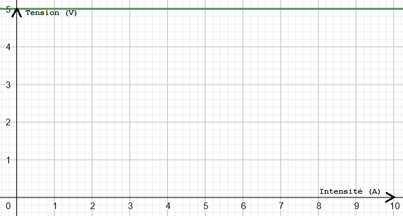
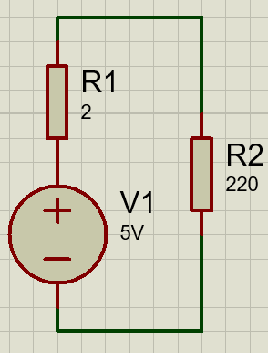
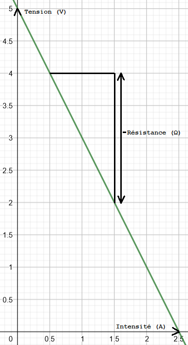
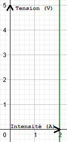
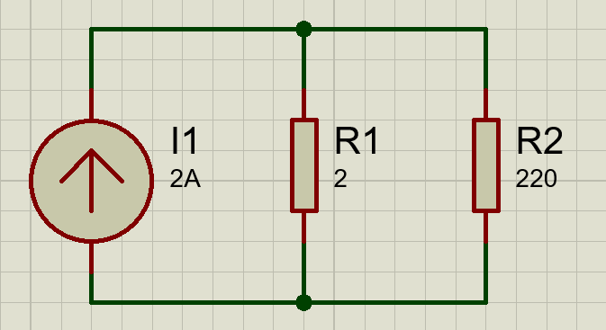
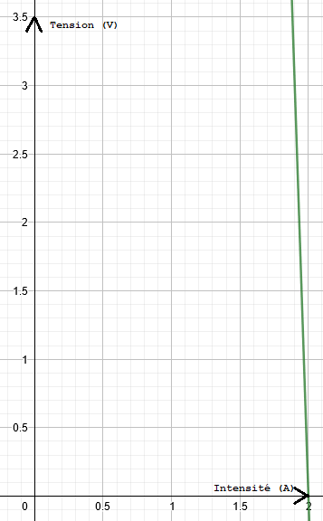

Comment alimenter un circuit n'est pas forcément la première chose à laquelle on pense quand on le conçoit ou lorsqu'on le dessine. Mais au final, c'est ce qui va faire que le circuit marche ou pas ! Dans cet article, nous allons voir quelle est la différence entre une source de tension et de courant et la différence entre un générateur parfait et réel.

## La source d'énergie électrique

La définition d'une source d'énergie est assez simple et elle est partout autour de nous. Une source d'énergie est un circuit ou un composant dont le but est de fournir via ses deux bornes que l'on peut appeler A et B une tension $U$ et une intensité $I$, soit une puissance $P$ qui est le produit de $U$ par $I$. Une puissance maximale notée généralement $P_{max}$ est donnée en raison de l'effet Joule dont nous reverrons l'implication dans les paragraphes sur les générateurs réels.

La manière dont la source va fournir l'énergie peut donc être séparée en deux grandes catégories :

- La tension est constante et l'intensité varie : c'est une [source de tension](#la-source-de-tension).
- L'intensité est constante et la tension varie : c'est une [source de courant](#la-source-de-courant).

## La source de tension

### La source de tension parfaite

Une source de tension parfaite est un générateur dont la tension est parfaitement constante et l'intensité varie en fonction de la charge.

La tension $U_{AB}$ aux bornes de la source est constante quelle que soit l'intensité du courant généré. La source est dite "idéale".

### La source de tension réelle - modèle de Thévenin

Pour des raisons évidentes, une source de tension parfaite ne peut pas exister. Si la tension est constante peu importe le courant $I$ débité par la source, cela sous-entendrait que la puissance augmenterait linéairement en fonction de l'intensité (pour $1000\,\text{A}$ et $5\,\text{V}$, nous aurions $5000\,\text{W}$, pour $100\,\text{kA}$, nous aurions $500\,\text{kW}$, etc... ce qui n'a évidemment aucun sens si on parle d'une batterie de téléphone par exemple).

En réalité, la source de tension doit prendre en compte les pertes par effet Joule. Pertes qui sont responsables de la limitation de puissance sur tous les types de générateurs. Pour modéliser cette perte par effet Joule, nous pouvons rajouter une résistance interne en série avec la source de tension.

On se retrouve donc avec un modèle équivalent à une source réelle de tension :

Ici on voit bien la résistance interne $R_1$ du générateur parfait $V_1$, permettant d'alimenter en énergie la résistance $R_2$.

On peut en déduire que la tension du générateur réel de tension (ici $V_1$ et $R_1$) sera mesurée aux bornes de l'ensemble formé par le générateur $V_1$ et la résistance $R_1$, et sera donnée par la formule suivante :

$$U = U_{V_1} - U_{R_1}$$

$$\Rightarrow U = U_{V_1} - (R_1 \cdot I)$$

Et cette fois-ci, la tension n'est bel et bien plus du tout constante mais plus l'intensité devient grande, et plus la chute de tension dans la résistance $R_1$ est grande à cause des pertes dues à l'effet Joule.

Nous voyons bien sur la courbe que le coefficient directeur est l'opposé de la valeur de la résistance interne de la source de tension.

Une résistance interne de $2\,\Omega$ peut être beaucoup ou peu selon les types d'alimentation et ce que l'on alimente. Mais avec cette résistance interne, nous pouvons remarquer que la tension chute assez vite et atteint $0\,\text{V}$ pour $I = 2{,}5\,\text{A}$ (En effet, $5 - (2 \cdot 2{,}5) = 0$ pour reprendre la formule).

Note : La résistance interne d'une source de tension peut être déterminée empiriquement avec la tension $U$ de l'alim pendant qu'elle tire du courant et la tension à vide $U_{V_1}$ de la source grâce à la formule :

$$U_{V_1} - U = U_{R_1}$$

$$R_1 = \frac{U_{R_1}}{I} = \frac{U_{V_1} - U}{I}$$

## La source de courant

### La source de courant parfaite

Une source de courant parfaite est un générateur dont le courant est parfaitement constant et la tension varie en fonction de la charge.

### La source de courant réelle - modèle de Norton

Pour les mêmes raisons qu'au-dessus, une telle source d'énergie ne peut pas exister.

Dans un circuit avec plusieurs résistances en série (cf. [source de tension réelle](#la-source-de-tension-réelle---modèle-de-thévenin)), la tension se sépare entre les résistances, ce qui était pratique pour modéliser les pertes dues à l'effet Joule. Dans le cas d'une source de courant, il faudrait que l'intensité se sépare entre les résistances... Pour cela nous allons mettre notre résistance interne en dérivation par rapport à la source !

Nous nous retrouvons donc avec un modèle équivalent à celui-ci :

La tension aux bornes de $R_2$ que l'on peut appeler $U_{R_2}$ se calcule donc avec la loi d'Ohm :

$$U_{R_2} = R_2 \cdot I_{R_2} = R_2 \cdot (I - I_{R_1})$$

Où :

- $I$ est l'intensité totale, ici $2\,\text{A}$
- $I_{R_1}$ est l'intensité qui passe dans la résistance interne
- $I_{R_2}$ est l'intensité qui passe dans la charge

Ce qui implique que :

$$I_{R_1} = I - I_{R_2} \Rightarrow I_{R_2} = I - I_{R_1} = I - \frac{U_{R_2}}{R_1}$$

Avec $U_{R_2} = U_{R_1}$ car les deux résistances sont en parallèle et donc soumises à la même tension.

Courbe prise avec $R_1 = 30\,\Omega$

La courbe représente donc la tension $U_{R_2}$ en fonction de $I_{R_2}$. L'équation de la courbe est :

$$U(I_{R_2}) = 30(2 - I_{R_2}) = 60 - 30 \cdot I_{R_2}$$

Elle donne quelques informations intéressantes sur ce circuit :
- Le coefficient directeur est négatif -> plus on tire de courant et plus la tension disponible aux bornes de $R_2$ diminue.
- Le point d'origine à $0\,\text{A}$ : quand le courant débité est nul (circuit ouvert, à vide), les $2\,\text{A}$ traversent $R_1$, ce qui produit la tension maximale à $60\,\text{V}$. On l'appelle la **tension à vide**.
- Le point d'intersection avec l'axe horizontal : lorsque la tension disponible pour la charge est nulle, l'intensité dans la résistance interne $R_1$ est nulle et tout le courant ($I_{R_2} = 2\,\text{A}$) passe dans la charge $R_2$ (en court-circuit). On l'appelle le **courant de court-circuit**.
- La puissance maximale transférée à la charge $R_2$ est toujours atteinte à la moitié du courant de court-circuit. Dans cet exemple, $1\,\text{A}$ traversant la résistance interne donnera $30\,\text{V}$ et $1\,\text{A}$ disponible pour la charge. La puissance sera donc maximale et de $30\,\text{W}$. Un exercice intéressant peut être de prouver cette propriété.
- La ressemblance de formule avec la [source de tension réelle](#la-source-de-tension-réelle---modèle-de-thévenin) nous donne une équivalence stricte. Une source de tension à $60\,\text{V}$ avec sa résistance interne de $30\,\Omega$ est strictement équivalente (du point de vue de la charge) à une source de courant à $2\,\text{A}$ avec la même résistance interne de $30\,\Omega$. Les modèles de Norton et de Thévenin sont donc totalement remplaçables en suivant cette méthode -> pour une résistance interne fixe, l'intensité du modèle de Norton est la même que l'intensité de court-circuit du modèle de Thévenin et la tension de Thévenin est la même que la tension à vide du modèle de Norton.
