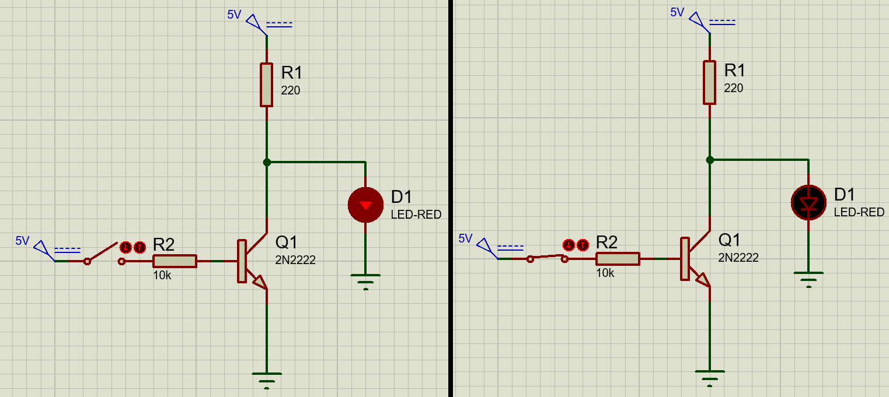
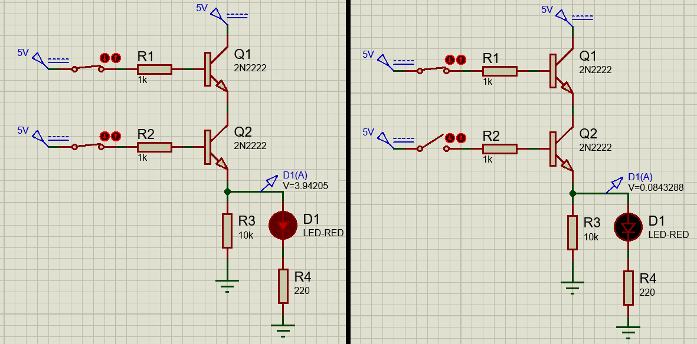
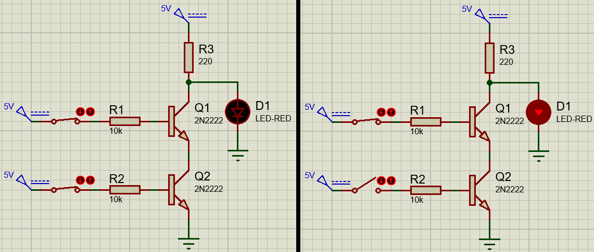
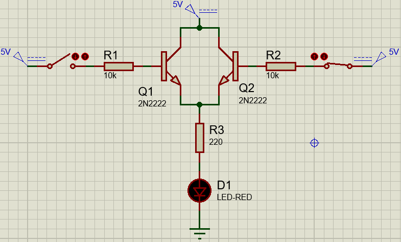
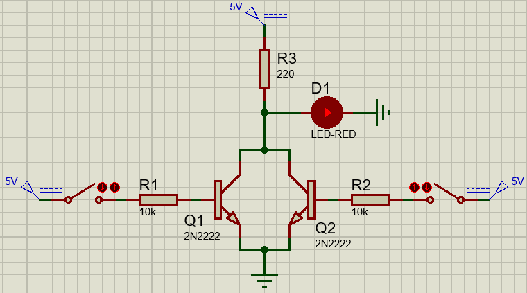
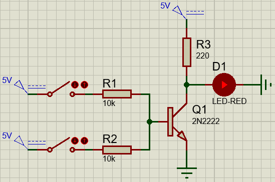
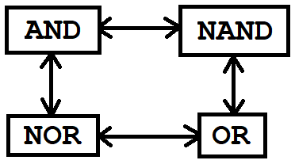
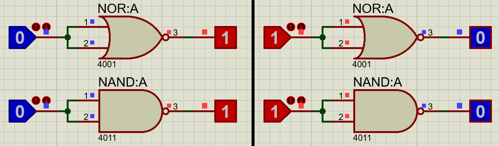
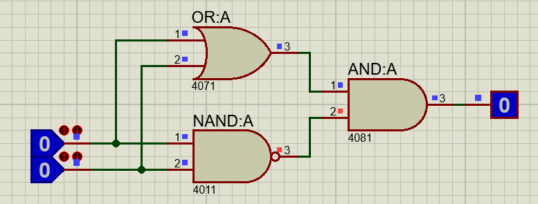
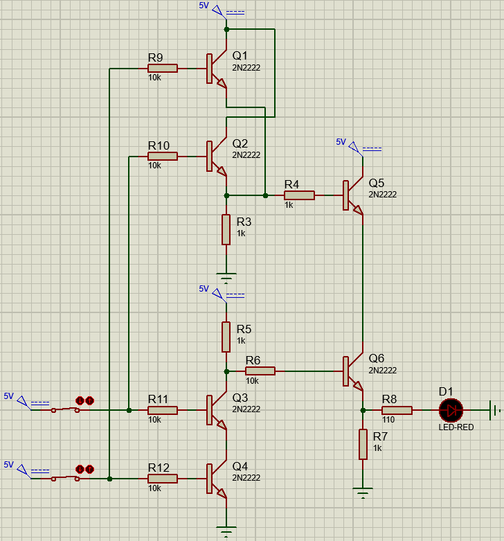

Les portes logiques marquent une étape cruciale dans la compréhension de l'électronique moderne, en éclairant la distinction fondamentale entre deux branches essentielles : l'électronique numérique et l'électronique analogique. L'électronique numérique s'attelle aux signaux discrets, échantillonnés et segmentés, tandis que l'électronique analogique se plonge dans le domaine des signaux continus, traitant des filtres, du bruit et des opérations sur les tensions. Pour saisir pleinement cette distinction, imaginez un fleuve fluide par opposition à un fleuve divisé en sections discrètes.

Le transistor, par sa capacité à servir d'interrupteur électriquement contrôlé, brille dans le monde de l'électronique numérique. Nous allons voir ici comment l'utiliser afin de créer le fondement de la logique numérique, les portes logiques.

## Qu'est-ce qu'une porte logique

Dans l'article précédent traitant du [transistor bipolaire](/electronics/basics/component-bipolar-junction-transistor/), nous avons découvert une propriété intéressante. Et c'est son régime de commutation (régime bloqué et saturé). En effet, lorsque l'intensité que l'on envoie dans la base est suffisamment grande, le transistor se met à agir comme un conducteur. En revanche, quand on n'envoie rien dans la base, le transistor agit comme un isolant, aucun courant ne passe.

Cela nous conduit à l'essence même de l'informatique moderne : les bits. En considérant l'état du transistor bloqué comme un 0 et saturé comme un 1, nous montons d'une couche d'abstraction ! Nous passons de la gestion de signaux analogiques à des valeurs binaires, sur lesquelles repose toute la logique numérique.

## Les portes principales

### Les portes OUI et NON

Pour décrire une porte logique, ainsi qu'une combinaison de portes logiques (nous verrons un exemple dans cet article), nous allons utiliser ce qu'on appelle une **table de vérité**. Derrière ce nom se cache un concept très simple, on met dans les x premières colonnes les x entrées de notre porte logique. On ajoute ensuite une colonne pour le résultat de la porte.

Le nombre de lignes du tableau représente toutes les combinaisons possibles que l'on peut appliquer aux entrées.

Voyons d'abord la table de vérité de la porte **OUI** :

| Entrée | Sortie |
|--------|--------|
| 0      | 0      |
| 1      | 1      |

En effet, cette porte ne fait rien 🙂. Il y a évidemment une subtilité, vous vous doutez bien. Un "buffer" ou un tampon en français est un composant chargé de répliquer en sortie ce qu'il reçoit à l'entrée. Il propose généralement une isolation électrique entre les entrées et sorties bien que ce ne soit pas toujours le cas ([un lien pour approfondir](https://fr.wikipedia.org/wiki/Buffer_(%C3%A9lectronique)))

Maintenant la porte **NON** :

| Entrée | Sortie |
|--------|--------|
| 0      | 1      |
| 1      | 0      |

La porte NON est tout simplement un inverseur, comme on peut le voir à sa table de vérité.

Son implémentation physique peut varier, un petit peu, voici celle que je vous propose :

On voit bien ici le fonctionnement. Quand il y a $0\,\text{V}$ à la base du transistor, ledit transistor est bloqué. Le courant passe donc du générateur à la résistance R1, puis à la diode D1. Quand il y a $5\,\text{V}$ sur la base, il devient saturé. Le courant passe donc par la résistance R1 puis par le transistor pour aller à la masse.

La représentation symbolique de cette porte est la suivante :

En effet, sur les symboles de portes logiques, le cercle signifie une inversion. On peut le retrouver devant une entrée ou une sortie pour simplifier les schémas.

### Les portes AND et NAND

La porte AND, ou ET en français est une porte qui a en sortie 1 si et seulement si les deux entrées sont à 1.

Voici sa table de vérité :

| A | B | Sortie |
|---|---|--------|
| 0 | 0 | 0      |
| 0 | 1 | 0      |
| 1 | 0 | 0      |
| 1 | 1 | 1      |

Ainsi que son implémentation électrique :

La lumière n'est allumée que lorsque les deux entrées sont à 1. On peut aussi noter quelque chose d'intéressant qu'on peut voir sur ce schéma, c'est la tension à la sortie du 2ème transistor qui n'est plus que d'environ $4\,\text{V}$ sur les $5\,\text{V}$ de l'alimentation. En effet, le premier transistor $Q_1$ étant proche de la saturation (faible chute $V_{CE(sat)} \approx 0{,}2\,\text{V}$), le second transistor $Q_2$ fonctionne en émetteur-suiveur : il impose entre sa base et son émetteur une chute égale à sa tension de seuil ($V_{BE} \approx 0{,}7\,\text{V}$), à laquelle s'ajoute la petite chute de tension dans sa résistance de base $R_2$. $4\,\text{V}$ suffisent cependant pour être considérés comme un 1 d'un point de vue logique (la tension de seuil $V_{BE}$ est d'environ $0{,}7\,\text{V}$ à titre général, mais lisez la datasheet de votre transistor quand même), ce n'est donc pas un véritable problème ici, mais ça peut influencer votre façon de concevoir un circuit (si vous voulez faire une porte ET à 50 entrées par exemple, pourquoi pas finalement ?).

Voici sa représentation symbolique :

La porte NAND, ou NON ET, est d'un point de vue logique une porte AND avec un NOT en sortie. Elle fait donc strictement l'inverse de la porte AND.

Voici sa table de vérité :

| A | B | Sortie |
|---|---|--------|
| 0 | 0 | 1      |
| 0 | 1 | 1      |
| 1 | 0 | 1      |
| 1 | 1 | 0      |

Ainsi que son implémentation :

Ici, on peut voir que même si d'un point de vue logique, on aurait pu se dire qu'on devait implémenter la porte NAND via une porte AND suivie d'une porte NOT en sortie, en réalité, nous n'avons pas besoin d'un transistor en plus, mais juste de déplacer la sortie. Parce qu'en effet, si Q1 ou Q2 est bloqué (à un 0 logique) alors le courant ne pourra pas aller verticalement par Q1 et Q2 pour rejoindre la masse, il passera donc dans la led D1. Si maintenant les deux interrupteurs sont enclenchés, les deux transistors seront saturés (à un 1 logique), le courant ira donc droit à la masse sans passer par la led. Ce qui est bien le comportement attendu.

Vous venez donc de le voir avec la porte NAND que l'on peut implémenter avec une porte AND suivie d'une porte NOT, mais l'implémentation des portes peut varier. En effet, une porte logique est en quelque sorte une couche d'abstraction, permettant de passer des tensions/courants aux bits. Peu importe votre circuit, tant qu'il respecte bien la table de vérité, il sera correct. Je montrerai un exemple avec la [porte OR](#les-portes-or-et-nor) plus bas dans l'article.

Sa représentation symbolique est donc la même que le AND, mais avec le cercle signifiant une inversion :

### Les portes OR et NOR

Outre la porte AND, il existe une deuxième porte fondamentale prenant deux entrées, et c'est la porte OR (OU en français). Cette porte renvoie 1 quand **au minimum** une de ses entrées est à 1.

Sa table de vérité est donc la suivante :

| A | B | Sortie |
|---|---|--------|
| 0 | 0 | 0      |
| 0 | 1 | 1      |
| 1 | 0 | 1      |
| 1 | 1 | 1      |

Ainsi que son implémentation :

On voit bien ici que les deux transistors ne sont pas montés en série comme dans la porte AND, mais en parallèle. Le fait de les avoir mis de façon symétrique permet de mieux comprendre le circuit, pour que le courant arrive jusqu'à la LED, il faut que soit Q1, soit Q2, soit les deux soient passants.

Son symbole est le suivant :

La porte NOR maintenant, est la porte OR avec une inversion sur sa sortie.

Sa table de vérité :

| A | B | Sortie |
|---|---|--------|
| 0 | 0 | 1      |
| 0 | 1 | 0      |
| 1 | 0 | 0      |
| 1 | 1 | 0      |

La porte NOR (ou NON OU) maintenant, peut être montée avec un NOT en sortie, mais elle peut tout comme la NAND être simplement construite en déplaçant la sortie :

Mais là vous pouvez vous dire "Ok, mais 1 quand tout vaut 0 et 0 dans les autres cas, c'est une porte NOT avec les deux entrées reliées sur la porte NOT ?"

Si vous vous êtes dit ça, bien joué ! En effet, on peut économiser un transistor en considérant la porte NOR comme un NOT (logique RTL). En effet, si l'entrée du NOT est à 0, la sortie est à 1, et si une seule entrée ou les deux sont à 1, alors la sortie est à 0. Ce qui est bien un NOR ! **Attention toutefois** au rôle indispensable des deux résistances d'entrée $R_1$ et $R_2$ ($10\,\text{k}\Omega$) sur la base de $Q_1$ : elles servent à sommer et isoler les deux entrées l'une de l'autre. Si vous reliiez directement deux sorties logiques actives sans ces résistances (l'une à $5\,\text{V}$ et l'autre à $0\,\text{V}$), vous créeriez un court-circuit franc entre le $5\,\text{V}$ et la masse !

Son symbole est, comme on pourrait l'imaginer, le même symbole que le OR, mais avec l'inversion :

## Représentation mathématique

En algèbre de Boole (la branche des mathématiques traitant de la logique booléenne -> celle traitée dans cet article), il y a quelques notations que je vais devoir présenter pour passer à la suite :

$$a + b = a \text{ ou } b$$

$$a \cdot b = a \text{ et } b$$

$$a \oplus b = a \text{ ou exclusif } b$$

$$\overline{a} = \text{l'inverse de } a$$

C'est tout ! On a déjà vu les portes logiques principales, donc apprendre les notations n'a rien de difficile !

Le ou exclusif est une des portes secondaires que nous verrons un peu plus bas.

## Les lois de De Morgan

Maintenant qu'on a vu les quatre portes principales (AND, NAND, OR, NOR), nous allons voir les lois (ou théorèmes) de De Morgan, qui permettent de toutes les relier !

Puisque je suis maléfique, je vais vous donner le résultat tel quel sans contexte :

$$\overline{a + b} = \overline{a} \cdot \overline{b}$$

$$\overline{a \cdot b} = \overline{a} + \overline{b}$$

Soit en remplaçant les symboles :

$$\text{NOT}(a \text{ OR } b) = (\text{NOT } a) \text{ AND } (\text{NOT } b)$$

$$\text{NOT}(a \text{ AND } b) = (\text{NOT } a) \text{ OR } (\text{NOT } b)$$

On commence déjà mieux à comprendre l'essence de ce théorème. Il existe une représentation graphique de ces lois que j'aime beaucoup, et la voici :

Une flèche horizontale représente une inversion de la sortie et une flèche verticale représente une inversion des entrées. On remarque donc que toutes les portes logiques principales sont liées grâce à l'ajout ou à la suppression de portes NOT !

Ce théorème est facilement démontrable, vous pouvez le faire chez vous. Je ne souhaite juste pas entrer dans des détails mathématiques ici.

## Les portes universelles

Que se passerait-il si l'on branche une seule entrée à un NOR ou un NAND ?

On n'aura plus que les lignes [0 et 0] ainsi que [1 et 1] de la table de vérité, soit ceci :

| A | A | Sortie |
|---|---|--------|
| 0 | 0 | 1      |
| 1 | 1 | 0      |

Si vous remarquez quelque chose qui vous semble familier, en effet, vous aurez raison. Ce sont deux façons de créer une porte NOT avec une porte NOR et une porte NAND !

Avec les lois de De Morgan vues juste avant, nous pouvons déduire une propriété du NAND et NOR extrêmement importante. On peut créer toutes les portes à partir de NAND ou de NOR uniquement ! Pouvoir tout construire à partir d'une seule porte augmente certes le coût en transistor, mais est bien pratique dans certains cas.

## Les portes secondaires

### XOR et XNOR

Le dernier couple de portes de l'article, le OU exclusif et son inverse ! Le OU exclusif renvoie 1 **si et seulement si une seule branche est à 1**, et pas les deux branches en même temps donc.

Si je l'ai classée comme porte secondaire, ce n'est pas en raison de son importance, mais parce qu'elle peut être construite à partir des portes principales, et nous allons ici trouver une combinaison ensemble !

Voici la table de vérité de la porte XOR :

| A | B | Sortie |
|---|---|--------|
| 0 | 0 | 0      |
| 0 | 1 | 1      |
| 1 | 0 | 1      |
| 1 | 1 | 0      |

Il y a trois méthodes principales pour créer la formule qu'il nous faudrait avec une table de vérité :

- Prendre chaque ligne donnant 1 une par une et simplement la retranscrire. Ici ça donnerait :

$$A \oplus B = (\overline{A} \cdot B) + (A \cdot \overline{B})$$

- Travailler directement sur les tables de vérité (c'est une méthode dite "à l'arrache" mais elle fonctionne plutôt bien selon les cas) :

La table de vérité de la porte OR

| A | B | Sortie |
|---|---|--------|
| 0 | 0 | 0      |
| 0 | 1 | 1      |
| 1 | 0 | 1      |
| 1 | 1 | 1      |

La table de vérité de la porte NAND

| A | B | Sortie |
|---|---|--------|
| 0 | 0 | 1      |
| 0 | 1 | 1      |
| 1 | 0 | 1      |
| 1 | 1 | 0      |

Pourquoi un OR et un NAND me dites-vous ? Si vous regardez bien, la porte XOR renvoie 1 aux mêmes endroits que la porte OR et NAND, à deux erreurs près pour 0/0 avec NAND et 1/1 avec OR... Si l'on ne pouvait garder que les lignes que ces deux portes ont en commun ça serait pas mal... Mais attendez, c'est exactement ce que fait la porte AND ! Renvoyer 1 en sortie seulement si les deux entrées valent 1 !

Nous avons donc notre nouvelle formule :

$$A \oplus B = (A \text{ OR } B) \text{ AND } (A \text{ NAND } B)$$

L'avantage de cette formule plutôt que celle d'avant ? Il n'y a que 2 branches connectées avec un AND comme celle plus haut (qui reliait deux branches avec un OR). Oui, c'est vrai, mais celle du haut inversait une entrée seulement par branche, ce qui nous aurait forcés à utiliser des portes NOT, et donc en tout d'avoir 5 portes au lieu de 3 pour celle-là !

- La troisième méthode, c'est l'usage de l'arsenal théorique ! En effet, trouver une combinaison de portes logiques "à l'arrache" est plutôt simple, mais trouver la version la plus simplifiée est plus dur. Et pour ça, on pourra utiliser tout un tas d'équivalences en algèbre de Boole pour simplifier les équations. Ce n'est pas très important à l'heure actuelle, ce sera le sujet d'un autre article.

Voici donc une représentation symbolique de cette formule :

À titre indicatif, voici son implémentation avec des transistors :

On voit bien le OR en haut (celui de l'article était dessiné avec ses deux branches symétriques), en bas le NAND et à droite le AND. Avec cet exemple, vous comprenez déjà mieux pourquoi on utilise les symboles plutôt que les transistors.

La porte XNOR est l'inverse de la porte XOR, voici sa table de vérité :

| A | B | Sortie |
|---|---|--------|
| 0 | 0 | 1      |
| 0 | 1 | 0      |
| 1 | 0 | 0      |
| 1 | 1 | 1      |

Ainsi que sa représentation symbolique :

Après avoir lu cet article, vous devriez être en capacité d'ajouter une porte NOT à l'arrière de la porte XOR précédente. Je vous le laisse donc en exercice (rien ne vous empêche de créer une nouvelle formule respectant la table de vérité) !

## Conclusion

En conclusion, après cet article plutôt long, les portes logiques constituent un des fondements essentiels de l'électronique numérique. Leur capacité à traiter des informations binaires en se basant sur les principes de commutation des transistors ouvre la voie à un vaste éventail d'applications, de l'informatique aux télécommunications en passant par l'électronique embarquée. À la prochaine fois !
